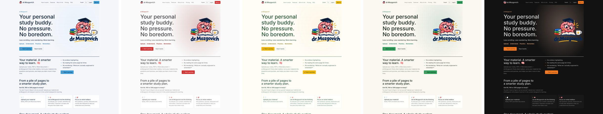
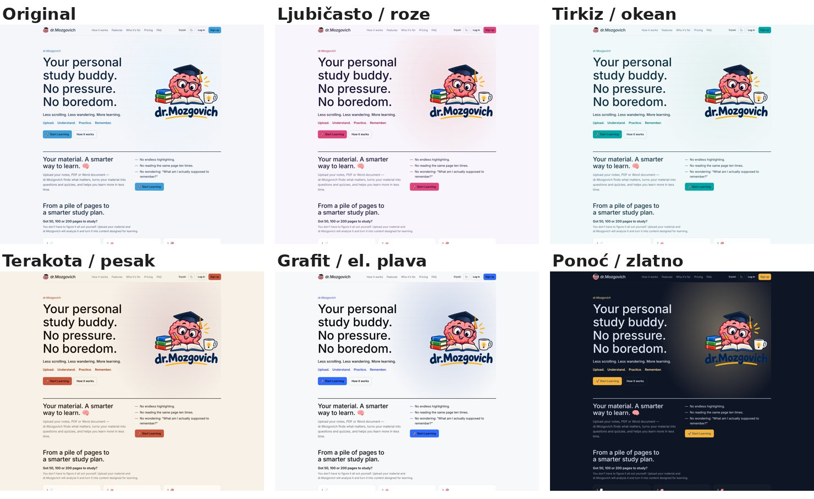
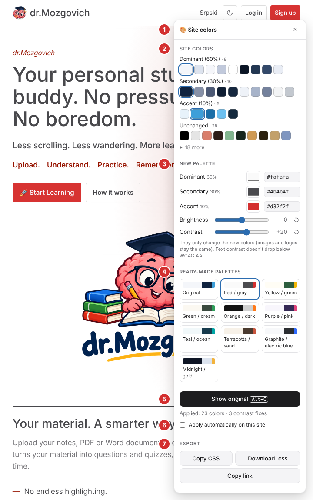
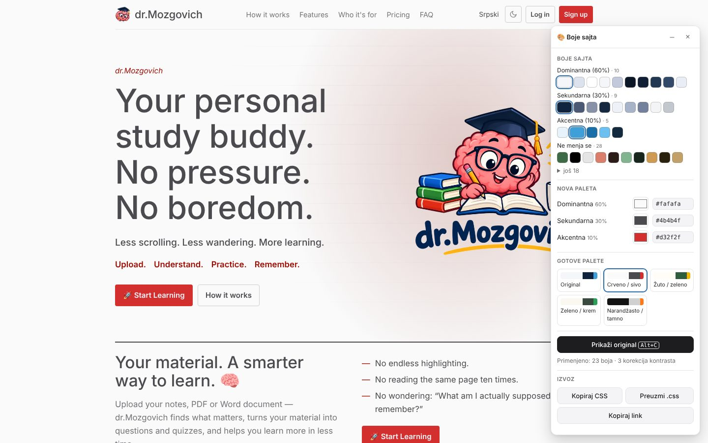

# Website Color Changer

**[English](#english)** · **[Srpski](#srpski)**

## English

A tool that changes the color palette of an existing website (the 60-30-10 rule) without changing its structure or functionality.

👉 **For users:** [Beginner's guide: the Chrome and Firefox extension](docs/USER-GUIDE.md). Ready-to-install files are in the [`downloads/`](downloads/) folder; the English versions have `_en` in the name:

| File | For |
|---|---|
| [`website-color-changer-chrome_en.zip`](downloads/website-color-changer-chrome_en.zip) | Chrome, Edge, Brave, Opera |
| [`website-color-changer-firefox_en.zip`](downloads/website-color-changer-firefox_en.zip) | Firefox |
| [`bookmarklet_en.html`](downloads/bookmarklet_en.html) | the bookmarklet (download it and open it in your browser) |

### The 60-30-10 rule

| Role | Share | Typically |
|---|---|---|
| **Dominant** | 60% | backgrounds |
| **Secondary** | 30% | text, cards, structure |
| **Accent** | 10% | calls to action: “Buy now”, “Sign up”, links |

You pick three colors (or a ready-made palette) and the tool maps every color of the site to the new palette. Each shade keeps its relation to the base color of its role, so hover states stay darker and light tints stay light. Text contrast is kept at WCAG AA (never above what the original had). The site's own dark mode, semantic colors (errors, success, charts) and other companies' logos are handled separately. The change is a reversible layer: the site's HTML and JavaScript are not modified.





### Panel in the browser (bookmarklet)

```bash
npm install
npm run build -w @cc/ui        # → packages/ui/dist/install_en.html (English), install.html (Serbian)
```

Open `packages/ui/dist/install_en.html` (or [`downloads/bookmarklet_en.html`](downloads/bookmarklet_en.html)) and drag the “🎨 Site colors” button to your bookmarks bar. On any website, clicking it opens the panel:

- **Site colors** — the detected palette grouped by role (60 / 30 / 10 / unchanged); click a color to change its role (remembered per domain).
- **New palette** — three color pickers (color picker + HEX) with a live preview.
- **Ready-made palettes** — Original and 9 combinations: Red/gray, Yellow/green, Green/cream, Orange/dark, Purple/pink, Teal/ocean, Terracotta/sand, Graphite/electric blue, Midnight/gold.
- **Show original / new palette** — A/B comparison, shortcut <kbd>Alt+C</kbd>.
- **Export** — copy or download the CSS for permanent use; “Copy link” gives a URL with the palette (`#cc=fafafa,4b4b4f,d32f2f`).

Closing the panel (×) restores the original site. The whole tool is inside the link (~94 KB); nothing is loaded from the internet.

On your own site (dev/staging) it can also run as a snippet that visitors don't see — the panel only appears with `?cc=1` or `#cc=…` in the URL:

```html
<script src="/cc-panel_en.min.js" data-cc-snippet defer></script>
```



### Chrome and Firefox extension

```bash
npm run build -w @cc/extension   # → packages/extension/dist/{chrome,firefox}_en (English), {chrome,firefox} (Serbian) + .zip
```

- **Chrome / Edge:** `chrome://extensions` → turn on *Developer mode* → *Load unpacked* → choose `packages/extension/dist/chrome_en`.
- **Firefox (140+):** `about:debugging#/runtime/this-firefox` → *Load Temporary Add-on…* → choose `packages/extension/dist/firefox_en/manifest.json`. For a permanent install the zip has to be signed on addons.mozilla.org.

Clicking the icon opens the same panel as the bookmarklet, with these differences:

| | Bookmarklet | Extension |
|---|---|---|
| Sites with a strict CSP | often blocked | works (the browser injects the code) |
| CSS from another domain without CORS | computed fallback (inline) | fetches the CSS, maps it through the CSS layer ¹ |
| Where palettes are stored | the site's `localStorage` | extension storage, listed in the settings |
| Automatic apply on page load | — | per site, switch in the panel ¹ |

¹ With the “access to all sites” permission, which is turned on in the extension's settings. Without it the extension only works on click (`activeTab`) and sees nothing else. The extension sends no data outside the browser. It fetches cross-origin CSS without cookies, only for stylesheets the page actually loads, only with `Content-Type: text/css`, and never from a private network for a page on another host.

### Production export (`cc-export`)

Once you have chosen a palette, the tool is no longer needed in production. One CSS file, included after the site's existing styles, is enough.

```bash
npm run build -w @cc/cli
node packages/cli/dist/cli.mjs https://drmozgovich.top --palette red-gray \
  --crawl 10 --out theme-override.css --map palette.map.json --report report.json --screenshots shots/
```

1. Visits pages (`--pages /,/contact` or `--crawl N` following same-domain links) in desktop and mobile viewports (`--viewports 1440,390`).
2. Merges the findings and classifies and maps the colors **once** for the whole site, so every page gets the same map. Each page and viewport has the same weight.
3. On each page, finds local contrast fixes (e.g. text on CTA buttons) and turns them into verified CSS rules.
4. Writes one `theme-override.css` (HEX colors, the same selectors, `@layer`, `@media` and dark mode as the site).
5. **Verification:** the CSS is added to every page as a plain stylesheet, without the tool, and the contrast of every visible text is measured. Elements that kept an old color (e.g. because of inline styles) are reported too. If any text loses contrast, the command exits with code 2, so it can be used in CI.

Other options: `--override "#e7f2fa=dominant"`, `--all-colors` (also changes semantic and chart colors), `--no-verify`, `--wait <ms>`. Colors in multicolor SVG graphics (e.g. the Google logo) are never changed. Palette names on the command line: `red-gray`, `yellow-green`, `green-cream`, `orange-dark`, `purple-pink`, `teal-ocean`, `terracotta-sand`, `graphite-blue`, `midnight-gold` (the Serbian names such as `crveno-sivo` work too). Messages and the comments in the generated CSS follow `--lang en|sr` (default: the system language).

#### Directly in the source files (PostCSS)

If you prefer to change the colors in the project's own CSS/SCSS files instead of adding a layer, use the map from `--map`:

```js
// postcss.config.js
import ccRemap from 'postcss-cc-remap';
export default {
  plugins: [ccRemap({ map: './palette.map.json', localRules: 'append' /* only for the main stylesheet */ })],
};
```

The plugin only changes values of declarations that carry a color: color properties, shorthands, `--css` and `$scss` variables. `url()`, strings, selectors and other properties stay untouched. A test confirms that the `cc-export` layer and the source CSS rewritten this way produce the same colors on the page.

### Development

```bash
npm install
npm test             # unit tests (Vitest)
npm run e2e          # Playwright + Chromium on the sites in fixtures/
LIVE=1 npm run e2e   # + tests against the live drmozgovich.top
npm run lint:firefox # web-ext lint for the Firefox builds
npm run typecheck
```

In the browser console (no install): inject `packages/core/dist/cc-core.iife.js` (`npm run build -w @cc/core`), then:

```js
CC.printPalette(await CC.scanDocument(document), console, 'en'); // just the palette
const engine = CC.createEngine(document, { lang: 'en' });
await engine.analyze();
engine.apply(CC.findPreset('red-gray'));             // or { dominant, secondary, accent }
engine.toggle();                                     // A/B: original ↔ new palette
console.log(engine.exportCss());                     // CSS for permanent use
```

| Package | Contents |
|---|---|
| `packages/core` | color math (OKLCH, gamut mapping, WCAG contrast), scanner, 60-30-10 classification, remapping, the engine that applies the palette as a reversible layer |
| `packages/ui` | the floating panel (Shadow DOM), bookmarklet and snippet mode — Serbian and English builds |
| `packages/extension` | Manifest V3 extension for Chrome and Firefox — Serbian and English builds |
| `packages/cli` | `cc-export`: multi-page production export with verification |
| `packages/postcss-cc-remap` | PostCSS plugin that applies the color map to source CSS/SCSS |

Technical specification: [docs/TECHNICAL-SPEC.md](docs/TECHNICAL-SPEC.md) (Serbian: [UPUTSTVO-ZA-KODIRANJE.md](docs/UPUTSTVO-ZA-KODIRANJE.md)).

---

## Srpski

Alat koji menja paletu boja gotovog sajta (pravilo 60-30-10) bez izmene njegove strukture i funkcionalnosti.

👉 **Za korisnike:** [Uputstvo za početnike: ekstenzija za Chrome i Firefox](docs/UPUTSTVO-ZA-KORISNIKE.md). Gotova ekstenzija za preuzimanje je u folderu [`downloads/`](downloads/):

| Fajl | Za |
|---|---|
| [`boje-sajta-chrome.zip`](downloads/boje-sajta-chrome.zip) | Chrome, Edge, Brave, Opera — na srpskom |
| [`boje-sajta-firefox.zip`](downloads/boje-sajta-firefox.zip) | Firefox — na srpskom |
| [`bookmarklet-boje-sajta.html`](downloads/bookmarklet-boje-sajta.html) | bookmarklet (preuzmi i otvori u browseru) — na srpskom |

Verzije na engleskom imaju `_en` u imenu (vidi [English](#english)).

📘 Tehnička specifikacija i plan implementacije: [docs/UPUTSTVO-ZA-KODIRANJE.md](docs/UPUTSTVO-ZA-KODIRANJE.md) (na engleskom: [TECHNICAL-SPEC.md](docs/TECHNICAL-SPEC.md))

### Panel u browseru (bookmarklet)

```bash
npm install
npm run build -w @cc/ui        # → packages/ui/dist/install.html (srpski), install_en.html (engleski)
```

Otvori `packages/ui/dist/install.html` i prevuci dugme „🎨 Boje sajta" u traku sa obeleživačima. Na bilo kom sajtu klik otvara panel:

- **Boje sajta** — detektovana paleta po ulogama (60 / 30 / 10 / ne menja se); klik na boju menja njenu ulogu (pamti se za domen).
- **Nova paleta** — tri izbornika boja (color picker + HEX) sa živim pregledom.
- **Gotove palete** — Original i 9 kombinacija: Crveno/sivo, Žuto/zeleno, Zeleno/krem, Narandžasto/tamno, Ljubičasto/roze, Tirkiz/okean, Terakota/pesak, Grafit/električno plava, Ponoć/zlatno.
- **Prikaži original / novu paletu** — A/B poređenje, prečica <kbd>Alt+C</kbd>.
- **Izvoz** — kopiraj ili preuzmi CSS za trajnu primenu; „Kopiraj link" daje URL sa paletom (`#cc=fafafa,4b4b4f,d32f2f`).

Zatvaranje panela (×) vraća sajt u original. Ceo alat je u samom linku (~94 KB), ništa se ne učitava sa interneta.

Na sopstvenom sajtu (dev/staging) može i kao snippet koji je nevidljiv posetiocima — panel se pojavljuje samo uz `?cc=1` ili `#cc=…` u URL-u:

```html
<script src="/cc-panel.min.js" data-cc-snippet defer></script>
```



### Ekstenzija za Chrome i Firefox

```bash
npm run build -w @cc/extension   # → packages/extension/dist/{chrome,firefox} (srpski), {chrome,firefox}_en (engleski) + .zip
```

- **Chrome / Edge:** `chrome://extensions` → uključi *Developer mode* → *Load unpacked* → izaberi `packages/extension/dist/chrome`.
- **Firefox (140+):** `about:debugging#/runtime/this-firefox` → *Load Temporary Add-on…* → izaberi `packages/extension/dist/firefox/manifest.json`. Za trajnu instalaciju zip treba potpisati na addons.mozilla.org.

Klik na ikonicu otvara isti panel kao bookmarklet, uz razlike:

| | Bookmarklet | Ekstenzija |
|---|---|---|
| Sajtovi sa strogom CSP | često blokiran | radi (kod ubacuje browser) |
| CSS sa drugog domena bez CORS-a | computed fallback (inline) | preuzima CSS, mapira kroz CSS sloj ¹ |
| Gde se pamte palete | `localStorage` sajta | memorija ekstenzije, pregled u podešavanjima |
| Automatska primena pri učitavanju | — | po sajtu, prekidač u panelu ¹ |

¹ Uz dozvolu „pristup svim sajtovima", koja se uključuje u podešavanjima ekstenzije. Bez nje ekstenzija radi samo na klik (`activeTab`) i ne vidi ništa drugo. Ekstenzija ne šalje nikakve podatke van browsera. CSS sa drugog domena preuzima bez kolačića, samo za stylesheet-ove koje stranica stvarno učitava, sa `Content-Type: text/css`, i nikad sa lokalne mreže za stranicu sa drugog hosta.

### Izvoz za produkciju (`cc-export`)

Kad izabereš paletu, alat u produkciji više nije potreban. Dovoljan je jedan CSS fajl koji se uključuje posle postojećih stilova sajta.

```bash
npm run build -w @cc/cli
node packages/cli/dist/cli.mjs https://drmozgovich.top --palette crveno-sivo \
  --crawl 10 --out theme-override.css --map paleta.map.json --report izvestaj.json --screenshots snimci/
```

1. Obilazi stranice (`--pages /,/kontakt` ili `--crawl N` prateći linkove sa iste domene) u desktop i mobilnom prikazu (`--viewports 1440,390`).
2. Spaja nalaze i boje klasifikuje i mapira **jednom**, za ceo sajt, pa sve stranice dobijaju istu mapu. Svaka stranica i prikaz imaju istu težinu.
3. Na svakoj stranici traži lokalne korekcije kontrasta (npr. tekst na CTA dugmadi) i pretvara ih u proverena CSS pravila.
4. Piše jedan `theme-override.css` (HEX boje, isti selektori, `@layer`, `@media` i dark mode kao na sajtu).
5. **Provera:** CSS se ubacuje u svaku stranicu kao običan stylesheet, bez alata, i meri se kontrast svakog vidljivog teksta. Prijavljuju se i elementi koji su ostali u staroj boji, npr. zbog inline stilova. Ako kontrast nekog teksta padne, komanda izlazi sa kodom 2, pa može da se koristi u CI-ju.

Ostale opcije: `--override "#e7f2fa=dominant"`, `--all-colors` (menja i semantičke boje i grafikone), `--no-verify`, `--wait <ms>`, `--lang sr|en` (jezik poruka i komentara u CSS-u; podrazumevano jezik sistema). Boje iz višebojnih SVG grafika (npr. Google logo) se nikad ne menjaju.

#### Direktno u izvornim fajlovima (PostCSS)

Ako je umesto dodatnog sloja draže da se boje promene u samim izvornim CSS/SCSS fajlovima projekta, koristi mapu iz `--map`:

```js
// postcss.config.js
import ccRemap from 'postcss-cc-remap';
export default {
  plugins: [ccRemap({ map: './paleta.map.json', localRules: 'append' /* samo za glavni stylesheet */ })],
};
```

Plugin menja samo vrednosti deklaracija koje nose boju: svojstva boja, shorthand-ove, `--css` i `$scss` varijable. `url()`, stringovi, selektori i ostala svojstva ostaju netaknuti. Test potvrđuje da sloj iz `cc-export` i ovako prepisani izvorni CSS daju iste boje na stranici.

### Razvoj

```bash
npm install
npm test          # unit testovi (Vitest)
npm run e2e       # skener na test sajtovima iz fixtures/ (Playwright + Chromium)
LIVE=1 npm run e2e   # + test nad živim drmozgovich.top
npm run lint:firefox # web-ext lint za Firefox build
npm run typecheck
```

#### Skeniranje pravog sajta

```bash
npx playwright install chromium   # jednom, lokalno
npm run scan -- https://moj-sajt.rs --json paleta.json
```

Sa `--palette crveno-sivo` (ili `--palette "#FAFAFA,#4B4B4F,#D32F2F"`) dodatno prikazuje klasifikaciju 60-30-10 i mapu stara → nova boja, sa korekcijama kontrasta. Preseti: `crveno-sivo`, `zuto-zeleno`, `zeleno-krem`, `narandzasto-tamno`, `ljubicasto-roze`, `tirkiz-okean`, `terakota-pesak`, `grafit-plavo`, `ponoc-zlatno`. Jezik ispisa: `--lang sr|en` (podrazumevano jezik sistema).

Dodaj `--screenshot snimci/` za snimke cele stranice pre i posle, i `--css paleta.css` za izvoz CSS sloja koji se trajno dodaje posle stilova sajta.


Ispisuje detektovanu paletu sa uzorcima boja, udelom u površini ekrana (pozadina / tekst / ivice / interaktivni elementi), mestima gde je boja deklarisana i CSS varijablama koje je nose. Opcije: `--width 390` (mobilni prikaz), `--dark` (`prefers-color-scheme: dark`), `--no-scroll`.

U browser konzoli (bez instalacije): ubaci `packages/core/dist/cc-core.iife.js` (`npm run build -w @cc/core`), pa:

```js
CC.printPalette(await CC.scanDocument(document));    // samo paleta
const engine = CC.createEngine(document);
await engine.analyze();
engine.apply(CC.PRESETS['crveno-sivo']);             // ili { dominant, secondary, accent }
engine.toggle();                                     // A/B: original ↔ nova paleta
console.log(engine.exportCss());                     // CSS za trajnu primenu
```

| Faza | Status |
|---|---|
| M1 — Color core (`packages/core/src/color`): parse, OKLCH konverzije, gamut mapping, kontrast, `replaceColors` | ✅ |
| M2 — Skener (`packages/core/src/scan`): CSSOM (+ `@import`, `@media`, `@layer`, nesting, `@keyframes`, cross-origin), inline stilovi, SVG/HTML atributi, CSS varijable, shadow DOM, ponder površine, parovi za kontrast | ✅ |
| M3 — Klasifikacija 60/30/10 (`src/analyze`) + remap i korekcija kontrasta (`src/map`); glavni test sajt: snimak drmozgovich.top (`fixtures/drmozgovich`, `test/fixtures/drmozgovich.scan.json`) | ✅ |
| M4 — Primena (`src/apply`, `src/engine.ts`): CSS sloj u `adoptedStyleSheets` (isti selektori/slojevi/media), inline/SVG atributi sa tačnim vraćanjem, lokalna korekcija kontrasta (CTA), computed fallback za CORS, MutationObserver, `toggle()`/`disable()`/`exportCss()` | ✅ |
| M5 — UI panel (`packages/ui`): Shadow DOM panel, uloge boja, izbornici, preseti, A/B (<kbd>Alt+C</kbd>), izvoz, link sa paletom, pamćenje po domenu; bookmarklet + `install.html`, snippet režim | ✅ |
| M6 — Ekstenzija (`packages/extension`, MV3 za Chrome i Firefox): klik → panel (CSP-otporno), CSS sa drugog domena preko ekstenzije uz bezbednosne provere, palete u memoriji ekstenzije, automatska primena po sajtu, stranica sa podešavanjima | ✅ |
| M7 — Izvoz za produkciju: `packages/cli` (`cc-export`: više stranica, crawl, desktop i mobilni prikaz, zajednička mapa, lokalne korekcije kao CSS pravila, provera bez alata, snimci) i `packages/postcss-cc-remap` (CSS/SCSS izvor) | ✅ |
