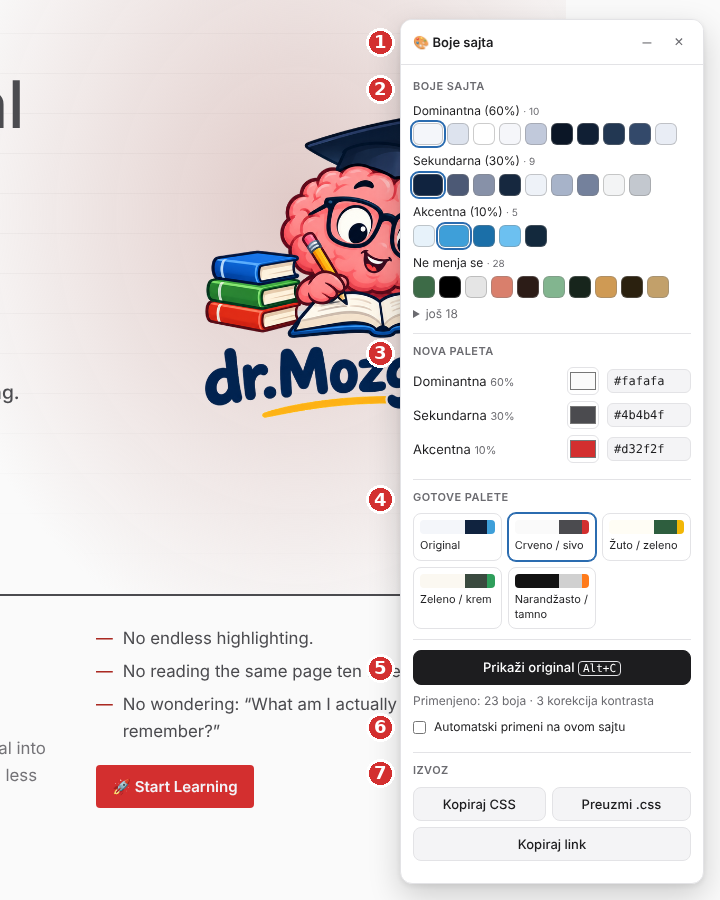
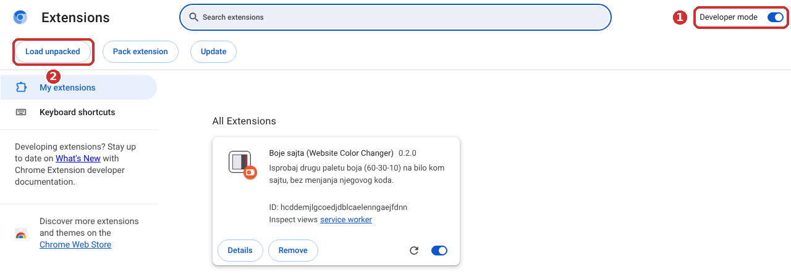
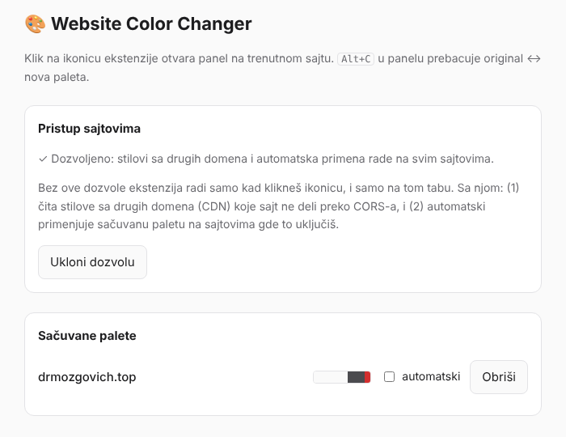

# 🎨 Boje sajta — uputstvo za početnike

Ovo uputstvo objašnjava, korak po korak, kako da instaliraš i koristiš ekstenziju **Boje sajta** (Website Color Changer) u Chrome-u i Firefox-u. Nije potrebno nikakvo programersko znanje.

---

## Šta ekstenzija radi?

Otvoriš bilo koji sajt, klikneš na ikonicu ekstenzije i dobiješ panel u kom biraš **tri boje**:

| Uloga | Koliko sajta zauzima | Gde se vidi |
|---|---|---|
| **Dominantna** | oko 60% | pozadine |
| **Sekundarna** | oko 30% | tekst, kartice, meniji |
| **Akcentna** | oko 10% | dugmad poput „Kupi odmah", „Prijavi se", linkovi |

Sajt se **odmah** prikazuje u novim bojama, tako da možeš da vidiš kako bi izgledao, na primer, u crveno-sivoj ili žuto-zelenoj varijanti.

**Ekstenzija ništa ne menja na samom sajtu.** Promena važi samo u tvom browseru i dok je ti uključiš. Osvežavanjem stranice ili zatvaranjem panela sve se vraća na original.

---

## 1. Preuzimanje

Preuzmi fajl za svoj browser:

- **Chrome, Edge, Brave, Opera:** [`boje-sajta-chrome.zip`](../downloads/boje-sajta-chrome.zip)
- **Firefox:** [`boje-sajta-firefox.zip`](../downloads/boje-sajta-firefox.zip)

> **Kako se preuzima sa GitHub-a:** klikni na ime fajla, pa na stranici koja se otvori klikni dugme **Download raw file** (ikonica strelice nadole, desno). Fajl će se snimiti u folder *Preuzimanja* (*Downloads*).

---

## 2A. Instalacija u Chrome-u

> Isto važi za **Edge** (`edge://extensions`), **Brave** (`brave://extensions`) i **Operu** (`opera://extensions`).

1. **Raspakuj zip.** Desni klik na `boje-sajta-chrome.zip` → **Extract All… / Raspakuj sve…** Dobićeš folder `boje-sajta-chrome`. Zapamti gde je; taj folder **ne briši**, jer ga Chrome koristi i posle instalacije.
2. U adresnu traku Chrome-a upiši **`chrome://extensions`** i pritisni Enter.
3. Gore desno uključi prekidač **Developer mode** (oznaka **1** na slici).
4. Klikni na **Load unpacked** (oznaka **2**).
5. Izaberi raspakovani folder **`boje-sajta-chrome`**, onaj u kome je fajl `manifest.json`, i klikni **Select Folder**.

Ekstenzija se pojavljuje na spisku kao **Website Color Changer**.

**Da ikonica bude stalno vidljiva:** klikni na ikonicu slagalice 🧩 desno od adresne trake i klikni na čiodu 📌 pored „Website Color Changer".

---

## 2B. Instalacija u Firefox-u

Firefox ima dva načina.

### Brzo: za isprobavanje (važi do zatvaranja Firefox-a)

1. U adresnu traku upiši **`about:debugging#/runtime/this-firefox`** i pritisni Enter.
2. Klikni **Load Temporary Add-on…**
3. Izaberi preuzeti fajl **`boje-sajta-firefox.zip`**. Ne moraš da ga raspakuješ.

Ekstenzija radi odmah. **Kada zatvoriš Firefox, ona nestaje** i sledeći put je ponovo učitaš na isti način.

### Trajno: potpisana ekstenzija

Firefox trajno instalira samo ekstenzije koje je potpisao Mozilla. Potpisivanje je besplatno, ekstenzija **ne mora** da bude javna i traje nekoliko minuta:

1. Napravi nalog na **[addons.mozilla.org](https://addons.mozilla.org/developers/)** i otvori **Developer Hub**.
2. Klikni **Submit a New Add-on** i izaberi **On your own** (samo za tebe, ne objavljuje se u prodavnici).
3. Pošalji fajl **`boje-sajta-firefox.zip`**.
4. Kad provera prođe, preuzmi potpisani **`.xpi`** fajl i prevuci ga u prozor Firefox-a, pa potvrdi sa **Add / Dodaj**.

**Da ikonica bude stalno vidljiva:** klikni na ikonicu slagalice 🧩 u traci, pa na zupčanik ⚙ pored „Website Color Changer" i izaberi **Pin to Toolbar**.

---

## 3. Prvo korišćenje

1. Otvori sajt koji želiš da isprobaš, na primer svoj.
2. Klikni na ikonicu ekstenzije 🎨 u traci.
3. U donjem desnom uglu pojavljuje se panel **Boje sajta**. Posle sekund-dve, dok ekstenzija pregleda boje sajta, panel je spreman.
4. Klikni na neku od **Gotovih paleta**, na primer **Crveno / sivo**. Sajt odmah menja boje.

To je sve! Ispod je objašnjenje svakog dela panela (brojevi odgovaraju slici sa početka uputstva).

### ① Zaglavlje
- **–** skuplja panel u traku, da ti ne smeta. Ponovni klik ga vraća.
- **×** zatvara panel i **vraća sajt u original**.
- Panel možeš da pomeriš: uhvati zaglavlje mišem i prevuci ga.

### ② Boje sajta
Ovo je **pregled originalnih boja sajta**, onakvih kakve su bile pre promene. Ovi kvadratići se **ne menjaju** kad biraš novu paletu; nove boje biraš u delu ③.

Boje su svrstane po **ulogama**: Dominantna, Sekundarna, Akcentna i **Ne menja se**. Glavna boja svake uloge je uokvirena. Uloga određuje koju boju iz „Nove palete" ta boja dobija: sve dominantne boje sajta dobijaju nijanse tvoje dominantne boje, i tako dalje.

U **Ne menja se** su boje koje namerno ne diramo: crvena za greške, zelena za uspeh, boje grafikona, tuđi logotipi (npr. Google logo na dugmetu za prijavu), providne senke i maske.

**Ako je neka boja svrstana pogrešno:**
1. Klikni na njen kvadratić. Otvara se mali meni sa objašnjenjem zašto je boja tu.
2. U padajućoj listi izaberi tačnu ulogu.
3. Boja se premešta u novu grupu, a ekstenzija to pamti za taj sajt.

Ako je na sajtu u tom trenutku **prikazan original**, sajt se neće promeniti dok ne primeniš paletu (gotovu paletu ili <kbd>Alt</kbd>+<kbd>C</kbd>), jer uloga utiče samo na **novu** paletu. Ako je nova paleta već primenjena, promena se vidi odmah.

Meni se zatvara drugim klikom na isti kvadratić, tasterom <kbd>Esc</kbd> ili klikom bilo gde pored.

### ③ Nova paleta
Tri boje koje biraš: **Dominantna**, **Sekundarna** i **Akcentna**.
- Klikni na kvadratić da izabereš boju iz palete, **ili**
- upiši HEX kod u polje pored, npr. `#d32f2f`.

Sajt se menja dok biraš. Ako upišeš nešto što nije boja, polje postaje crveno i ništa se ne menja.

### ④ Gotove palete
Kombinacije za brzo isprobavanje: **Crveno / sivo**, **Žuto / zeleno**, **Zeleno / krem**, **Narandžasto / tamno**. **Original** vraća prave boje sajta.

### ⑤ Prikaži original / Prikaži novu paletu
Prebacivanje između originala i nove palete, da lako uporediš. Isto radi i prečica na tastaturi:

- **Windows / Linux:** <kbd>Alt</kbd> + <kbd>C</kbd>
- **Mac:** <kbd>Option ⌥</kbd> + <kbd>C</kbd>

Ispod dugmeta piše koliko boja je promenjeno i da li je ekstenzija nešto popravila zbog čitljivosti (vidi [Kontrast](#kontrast-čitljivost-teksta)).

### ⑥ Automatski primeni na ovom sajtu
Kad je uključeno, izabrana paleta se primenjuje **svaki put kad otvoriš ovaj sajt**, bez otvaranja panela. Za to je potrebna dodatna dozvola; vidi [Dozvole](#5-podešavanja-i-dozvole).

### ⑦ Izvoz
- **Kopiraj CSS:** kopira kod sa novim bojama, da ga pošalješ programeru ili ubaciš na sajt (vidi [Kako da nove boje stavim na pravi sajt?](#6-kako-da-nove-boje-stavim-na-pravi-sajt)).
- **Preuzmi .css:** isto to, ali kao fajl.
- **Kopiraj link:** link ka trenutnoj stranici sa tvojom paletom, npr. `…#cc=fafafa,4b4b4f,d32f2f`. Kad neko ko ima ovu ekstenziju otvori link i klikne ikonicu 🎨, odmah vidi istu varijantu.

---

## 4. Šta ekstenzija pamti

- **Poslednju paletu za svaki sajt.** Kad sledeći put otvoriš panel na tom sajtu, izbornici već imaju tvoje boje. Na sajt se primenjuju kad klikneš **Primeni paletu** ili pritisneš <kbd>Alt</kbd>+<kbd>C</kbd>.
- **Tvoje ispravke uloga boja** (korak ②).
- **Položaj panela** i da li je skupljen.

Sve se čuva **samo u tvom browseru**. Ekstenzija nikome ništa ne šalje.

---

## 5. Podešavanja i dozvole

**Kako se otvaraju podešavanja:**
- **Chrome:** desni klik na ikonicu 🎨 → **Options** (Opcije)
- **Firefox:** desni klik na ikonicu 🎨 → **Manage Extension** → kartica **Options / Preferences**

### Sačuvane palete
Spisak sajtova za koje si sačuvao paletu. Kod svakog možeš da uključiš ili isključiš **automatski** ili da ga **obrišeš**.

### Pristup sajtovima
Po podrazumevanim podešavanjima ekstenzija radi **samo kada klikneš ikonicu, i samo na tom tabu**. Ne vidi nijedan drugi sajt.

Dugme **Dozvoli pristup svim sajtovima** je potrebno samo za dve stvari:
1. **Automatsku primenu** palete (korak ⑥).
2. Sajtove koji učitavaju stilove sa drugih adresa. Bez dozvole ekstenzija i tada radi, samo malo manje precizno.

Browser će te pitati da potvrdiš („Read and change all your data on all websites" / „Pristup podacima na svim sajtovima"). Dozvolu možeš kad god da ukloniš dugmetom **Ukloni dozvolu**.

---

## 6. Kako da nove boje stavim na pravi sajt?

Ekstenzija služi za **isprobavanje**. Kad nađeš paletu koja ti se dopada:

1. U panelu klikni **Preuzmi .css** (ili **Kopiraj CSS**).
2. Taj kod treba dodati na sajt **posle** postojećih stilova:
   - **Ako sajt radi programer:** pošalji mu fajl i reci da ga uključi kao poslednji stylesheet.
   - **WordPress:** *Izgled → Prilagodi → Dodatni CSS* (*Appearance → Customize → Additional CSS*). Nalepi kod i klikni **Objavi**.
   - **Drugi sistemi (Shopify, Wix, Webflow…):** potraži opciju *Custom CSS* ili *Dodatni CSS* u podešavanjima teme.

> Za ceo sajt odjednom (sve stranice, i telefon i računar) postoji i alat za programere, `cc-export`, opisan u [README-u](../README.md#izvoz-za-produkciju-cc-export). On pravi jedan proveren CSS fajl.

---

## Kontrast (čitljivost teksta)

Ako izabrana boja čini neki tekst teškim za čitanje (npr. beli tekst na žutom dugmetu), ekstenzija **sama malo potamni ili posvetli taj tekst**, tako da ostane čitljiv. Nijansa tvoje boje ostaje ista. U panelu tada piše „… korekcija kontrasta".

Ako baš ne može da se popravi, panel to prikaže narandžastim tekstom „⚠ Kontrast ispod cilja". Probaj tada svetliju ili tamniju akcentnu boju.

---

## Ažuriranje na novu verziju

Kad u folderu `downloads/` izađe nova verzija:

- **Chrome:** preuzmi novi zip i raspakuj ga **preko starog** foldera `boje-sajta-chrome`, tako da zameni postojeće fajlove. Zatim na `chrome://extensions` klikni ikonicu za ponovno učitavanje ⟳ na kartici „Website Color Changer". Broj verzije na kartici treba da se promeni.
- **Firefox (privremeno učitana):** na `about:debugging#/runtime/this-firefox` klikni **Remove** kod stare verzije, pa ponovo **Load Temporary Add-on…** sa novim zip-om.
- **Firefox (potpisana):** novi zip ponovo pošalji na potpisivanje, pa instaliraj novi `.xpi`.

Sačuvane palete ostaju posle ažuriranja.

## Česta pitanja i problemi

| Problem | Rešenje |
|---|---|
| Ne vidim ikonicu ekstenzije | Klikni na slagalicu 🧩 u traci i „pribodi" ekstenziju (vidi korake 2A/2B). |
| Klik na ikonicu ne radi ništa | Na nekim stranicama browser **ne dozvoljava** ekstenzije: `chrome://…`, `about:…`, Chrome Web Store, addons.mozilla.org, PDF fajlovi. Probaj na običnom sajtu. Ako je stranica bila otvorena pre instalacije ekstenzije, osveži je (<kbd>F5</kbd>). |
| U Firefox-u je ekstenzija nestala | Učitana je kao *privremena*, pa nestaje kad se Firefox zatvori. Učitaj je ponovo ili je trajno potpiši (korak 2B). |
| Chrome prikazuje upozorenje o „developer mode" ekstenzijama | To je normalno za ekstenzije instalirane iz foldera. Klikni **Zadrži / Keep**, ili zatvori poruku. |
| Ekstenzija je nestala posle brisanja foldera | Chrome koristi raspakovani folder; ne brisati ga. Raspakuj zip ponovo i ponovi korake 2A. |
| Logo ili slike nisu promenili boju | Tako je namerno: ekstenzija menja samo boje iz CSS-a, ne slike. Logo sajta je obično slika. |
| Neka boja je u pogrešnoj ulozi | Klikni na nju u delu ② i izaberi tačnu ulogu. |
| Hoću da vratim original | Klikni **Original** u gotovim paletama, pritisni <kbd>Alt</kbd>+<kbd>C</kbd>, zatvori panel (**×**) ili osveži stranicu. |
| Kako da uklonim ekstenziju? | **Chrome:** `chrome://extensions` → **Remove**. **Firefox:** desni klik na ikonicu → **Remove Extension**. |

---

## Kratak podsetnik

| Šta hoću | Kako |
|---|---|
| Otvori/sakrij panel | klik na ikonicu 🎨 |
| Isprobaj gotovu paletu | klik na paletu u delu ④ |
| Svoje boje | kvadratići ili HEX polja u delu ③ |
| Uporedi sa originalom | <kbd>Alt</kbd>+<kbd>C</kbd> (Mac: <kbd>⌥</kbd>+<kbd>C</kbd>) |
| Ispravi ulogu boje | klik na boju u delu ② |
| Sačuvaj za ovaj sajt | pamti se samo; za automatsku primenu uključi ⑥ |
| Daj boje programeru | **Preuzmi .css** u delu ⑦ |
| Vrati sve na original | **×** na panelu ili osveži stranicu |
