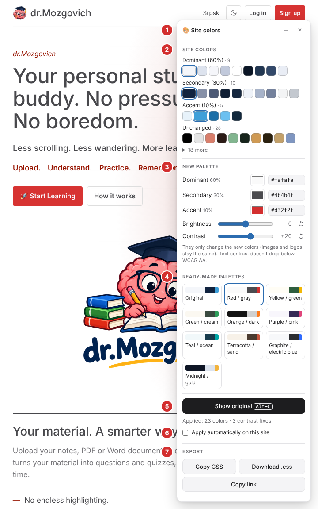
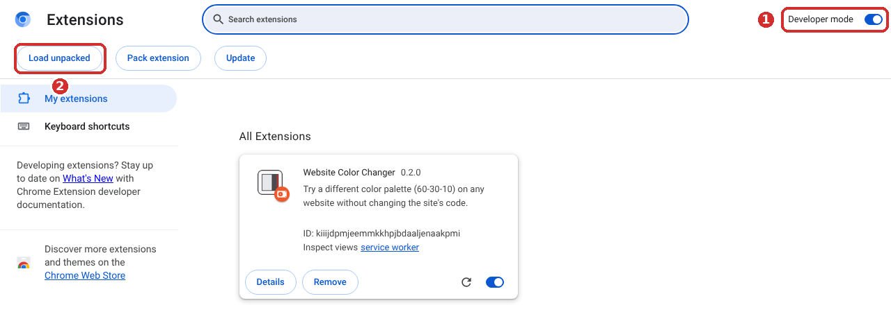
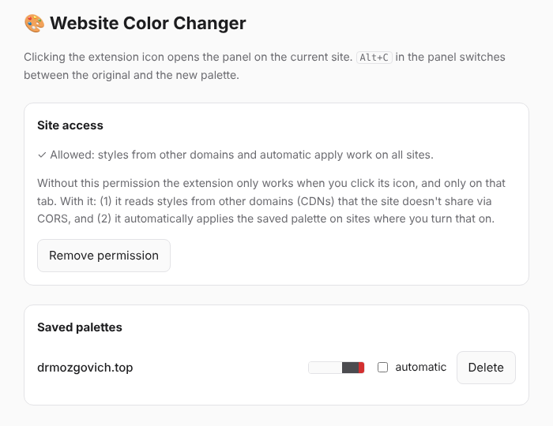

# 🎨 Website Color Changer — beginner's guide

🇷🇸 *Srpska verzija: [UPUTSTVO-ZA-KORISNIKE.md](UPUTSTVO-ZA-KORISNIKE.md)*

This guide explains, step by step, how to install and use the **Website Color Changer** extension in Chrome and Firefox. No programming knowledge is needed.

---

## What does the extension do?

Open any website, click the extension icon, and you get a panel where you choose **three colors**:

| Role | Share of the site | Where you see it |
|---|---|---|
| **Dominant** | about 60% | backgrounds |
| **Secondary** | about 30% | text, cards, menus |
| **Accent** | about 10% | buttons like “Buy now”, “Sign up”, links |

The site is **instantly** shown in the new colors, so you can see how it would look, for example, in red and gray or in teal.

**The extension does not change the website itself.** The change only exists in your browser, and only while you have it turned on. Reloading the page or closing the panel brings back the original.

---

## 1. Download

Download the file for your browser:

- **Chrome, Edge, Brave, Opera:** [`website-color-changer-chrome_en.zip`](../downloads/website-color-changer-chrome_en.zip)
- **Firefox:** [`website-color-changer-firefox_en.zip`](../downloads/website-color-changer-firefox_en.zip)

These are the English versions (`_en`). The Serbian versions are `boje-sajta-chrome.zip` and `boje-sajta-firefox.zip`. Both can be installed at the same time.

> **How to download from GitHub:** click the file name, then on the page that opens click the **Download raw file** button (down-arrow icon, on the right). The file is saved to your *Downloads* folder.

---

## 2A. Installing in Chrome

> The same steps work in **Edge** (`edge://extensions`), **Brave** (`brave://extensions`) and **Opera** (`opera://extensions`).

1. **Unzip the file.** Right-click `website-color-changer-chrome_en.zip` → **Extract All…** You get a folder named `website-color-changer-chrome_en`. Remember where it is, and **don't delete** it: Chrome keeps using it after installation.
2. Type **`chrome://extensions`** in Chrome's address bar and press Enter.
3. In the top-right corner, turn on **Developer mode** (marker **1** in the picture).
4. Click **Load unpacked** (marker **2**).
5. Select the unzipped folder **`website-color-changer-chrome_en`**, the one that contains `manifest.json`, and click **Select Folder**.

The extension appears in the list as **Website Color Changer**.

**To keep the icon visible:** click the puzzle icon 🧩 to the right of the address bar, then click the pin 📌 next to “Website Color Changer”.

---

## 2B. Installing in Firefox

Firefox has two ways.

### Quick: for trying it out (lasts until Firefox is closed)

1. Type **`about:debugging#/runtime/this-firefox`** in the address bar and press Enter.
2. Click **Load Temporary Add-on…**
3. Choose the downloaded file **`website-color-changer-firefox_en.zip`**. You don't need to unzip it.

The extension works right away. **When you close Firefox, it is removed**, and next time you load it again the same way.

### Permanent: a signed extension

Firefox only installs extensions permanently if Mozilla has signed them. Signing is free, the extension **does not** have to be public, and it takes a few minutes:

1. Create an account on **[addons.mozilla.org](https://addons.mozilla.org/developers/)** and open the **Developer Hub**.
2. Click **Submit a New Add-on** and choose **On your own** (just for you, not published in the store).
3. Upload **`website-color-changer-firefox_en.zip`**.
4. When the check passes, download the signed **`.xpi`** file, drag it into a Firefox window and confirm with **Add**.

**To keep the icon visible:** click the puzzle icon 🧩 in the toolbar, then the gear ⚙ next to “Website Color Changer”, and choose **Pin to Toolbar**.

---

## 3. First use

1. Open the website you want to try, for example your own.
2. Click the extension icon 🎨 in the toolbar.
3. The **Site colors** panel appears in the bottom-right corner. After a second or two, while the extension looks at the site's colors, the panel is ready.
4. Click one of the **Ready-made palettes**, for example **Red / gray**. The site changes color immediately.

That's it! Below is an explanation of every part of the panel (the numbers match the picture at the top of this guide).

### ① Header
- **–** collapses the panel into a bar so it's out of the way. Click again to expand it.
- **×** closes the panel and **restores the original site**.
- You can move the panel: grab the header with the mouse and drag it.

### ② Site colors
This is an **overview of the site's original colors**, as they were before any change. These swatches **do not change** when you pick a new palette; you pick the new colors in part ③.

The colors are grouped by **role**: Dominant, Secondary, Accent and **Unchanged**. The main color of each role has a frame. The role decides which color from the “New palette” a color gets: all of the site's dominant colors get shades of your dominant color, and so on.

**Unchanged** holds colors that are deliberately left alone: red for errors, green for success, chart colors, other companies' logos (e.g. the Google logo on a sign-in button), translucent shadows and masks.

**If a color is in the wrong group:**
1. Click its swatch. A small menu opens, explaining why the color is there.
2. Choose the correct role from the drop-down list.
3. The color moves to the new group, and the extension remembers this for the site.

If the site is currently **showing the original**, it won't change until you apply a palette (a ready-made palette or <kbd>Alt</kbd>+<kbd>C</kbd>), because the role only affects the **new** palette. If a new palette is already applied, you see the change immediately.

The menu closes when you click the same swatch again, press <kbd>Esc</kbd>, or click anywhere else.

### ③ New palette
The three colors you choose: **Dominant**, **Secondary** and **Accent**.
- Click the swatch to pick a color from the color picker, **or**
- type a HEX code into the field next to it, e.g. `#d32f2f`.

The site changes as you pick. If you type something that isn't a color, the field turns red and nothing changes.

Below the colors are two sliders:
- **Brightness** makes all the new colors lighter (to the right) or darker (to the left).
- **Contrast** moves light and dark colors further apart (to the right) or closer together (to the left).

They only change the new colors, so photos and logos stay the same. They stay where they are when you pick another palette. Click **↺**, or double-click the slider, to set it back to 0. Text always stays readable: even with Contrast all the way to the left, text doesn't drop below the WCAG AA level (see “Contrast” below).

### ④ Ready-made palettes
Ten buttons for quick testing. **Original** brings back the site's real colors; the other nine are ready-made combinations:

| Palette | Dominant (60%) | Secondary (30%) | Accent (10%) |
|---|---|---|---|
| Red / gray | almost white | dark gray | red |
| Yellow / green | warm white | dark green | yellow |
| Green / cream | cream | gray-green | green |
| Orange / dark | almost black | light gray | orange |
| Purple / pink | lavender white | deep purple | pink |
| Teal / ocean | ice white | petrol blue | teal |
| Terracotta / sand | sand | brown | terracotta |
| Graphite / electric blue | cool white | graphite | electric blue |
| Midnight / gold | midnight blue | light | gold |

**Orange / dark** and **Midnight / gold** are dark palettes: a light site becomes dark and the text becomes light.

### ⑤ Show original / Show new palette
Switches between the original and the new palette so you can compare easily. The keyboard shortcut does the same:

- **Windows / Linux:** <kbd>Alt</kbd> + <kbd>C</kbd>
- **Mac:** <kbd>Option ⌥</kbd> + <kbd>C</kbd>

Below the button you can see how many colors were changed and whether the extension fixed anything for readability (see [Contrast](#contrast-text-readability)).

### ⑥ Apply automatically on this site
When turned on, the chosen palette is applied **every time you open this site**, without opening the panel. This needs an extra permission; see [Permissions](#5-settings-and-permissions).

### ⑦ Export
- **Copy CSS:** copies the code with the new colors, so you can send it to a developer or add it to the site (see [How do I put the new colors on the real site?](#6-how-do-i-put-the-new-colors-on-the-real-site)).
- **Download .css:** the same thing, as a file.
- **Copy link:** a link to the current page with your palette, e.g. `…#cc=fafafa,4b4b4f,d32f2f`. When someone who has this extension opens the link and clicks the 🎨 icon, they see the same variant right away.

---

## 4. What the extension remembers

- **The last palette for each site.** The next time you open the panel on that site, the pickers already have your colors. They are applied to the site when you click **Apply palette** or press <kbd>Alt</kbd>+<kbd>C</kbd>.
- **The Brightness and Contrast sliders** (part ③), together with the palette.
- **Your color role corrections** (part ②).
- **The panel's position** and whether it is collapsed.

Everything is stored **only in your browser**. The extension doesn't send anything to anyone.

---

## 5. Settings and permissions

**How to open the settings:**
- **Chrome:** right-click the 🎨 icon → **Options**
- **Firefox:** right-click the 🎨 icon → **Manage Extension** → **Options / Preferences** tab

### Saved palettes
A list of the sites for which you have saved a palette. For each one you can turn **automatic** apply on or off, or **delete** it.

### Site access
By default the extension works **only when you click its icon, and only on that tab**. It cannot see any other site.

The **Allow access to all sites** button is only needed for two things:
1. **Applying a palette automatically** (part ⑥).
2. Sites that load their styles from other addresses. Without the permission the extension still works there, just slightly less precisely.

Your browser will ask you to confirm (“Read and change all your data on all websites”). You can remove the permission at any time with **Remove permission**.

---

## 6. How do I put the new colors on the real site?

The extension is for **trying things out**. When you find a palette you like:

1. In the panel, click **Download .css** (or **Copy CSS**).
2. That code has to be added to the site **after** its existing styles:
   - **If a developer runs your site:** send them the file and ask them to include it as the last stylesheet.
   - **WordPress:** *Appearance → Customize → Additional CSS*. Paste the code and click **Publish**.
   - **Other platforms (Shopify, Wix, Webflow…):** look for a *Custom CSS* or *Additional CSS* option in the theme settings.

> For a whole site at once (all pages, phone and desktop) there is also a developer tool, `cc-export`, described in the [README](../README.md#production-export-cc-export). It produces one verified CSS file.

---

## Contrast (text readability)

If a chosen color makes some text hard to read (e.g. white text on a yellow button), the extension **automatically darkens or lightens that text a little** so it stays readable. The hue of your color stays the same. The panel then says “… contrast fixes”.

If it really can't be fixed, the panel shows an orange “⚠ Contrast below target” message. Try a lighter or darker accent color.

---

## Updating to a new version

When a new version appears in the `downloads/` folder:

- **Chrome:** download the new zip and unzip it **over the old** `website-color-changer-chrome_en` folder, replacing the existing files. Then on `chrome://extensions` click the reload icon ⟳ on the “Website Color Changer” card. The version number on the card should change.
- **Firefox (temporary):** on `about:debugging#/runtime/this-firefox` click **Remove** on the old version, then **Load Temporary Add-on…** again with the new zip.
- **Firefox (signed):** submit the new zip for signing again and install the new `.xpi`.

Your saved palettes are kept after updating.

## Frequently asked questions and problems

| Problem | Solution |
|---|---|
| I can't see the extension icon | Click the puzzle icon 🧩 in the toolbar and pin the extension (see steps 2A/2B). |
| Clicking the icon does nothing | On some pages browsers **don't allow** extensions: `chrome://…`, `about:…`, the Chrome Web Store, addons.mozilla.org, PDF files. Try a normal website. If the page was open before you installed the extension, reload it (<kbd>F5</kbd>). |
| The extension disappeared in Firefox | It was loaded as *temporary*, so it is removed when Firefox closes. Load it again or sign it permanently (step 2B). |
| Chrome shows a warning about “developer mode” extensions | That's normal for extensions installed from a folder. Click **Keep**, or close the message. |
| The extension disappeared after I deleted the folder | Chrome uses the unzipped folder; don't delete it. Unzip the file again and repeat step 2A. |
| The logo or images didn't change color | That's intentional: the extension only changes colors from CSS, not images. A site's logo is usually an image. |
| A color is in the wrong role | Click it in part ② and choose the correct role. |
| I want to go back to the original | Click **Original** in the ready-made palettes, press <kbd>Alt</kbd>+<kbd>C</kbd>, close the panel (**×**) or reload the page. |
| How do I remove the extension? | **Chrome:** `chrome://extensions` → **Remove**. **Firefox:** right-click the icon → **Remove Extension**. |

---

## Quick reference

| I want to… | How |
|---|---|
| Open/hide the panel | click the 🎨 icon |
| Try a ready-made palette | click a palette in part ④ |
| Use my own colors | the swatches or HEX fields in part ③ |
| Make everything lighter/darker or sharper/softer | the **Brightness** and **Contrast** sliders in part ③ |
| Compare with the original | <kbd>Alt</kbd>+<kbd>C</kbd> (Mac: <kbd>⌥</kbd>+<kbd>C</kbd>) |
| Fix a color's role | click the color in part ② |
| Save for this site | saved automatically; for automatic apply turn on ⑥ |
| Give the colors to a developer | **Download .css** in part ⑦ |
| Restore everything | **×** on the panel, or reload the page |
